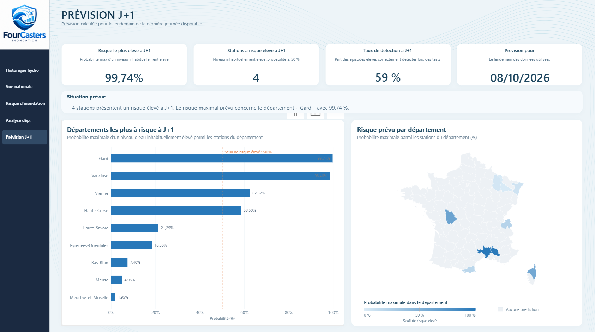
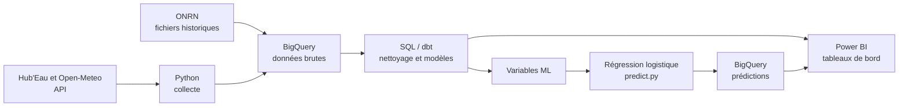

# FourCasters — Explorer les données hydrologiques en France

[](https://github.com/eddy370/FourCasters/actions/workflows/pipeline.yml)

**Projet réalisé pendant la formation Data Analyst de la Wild Code School, au sein d'un groupe de quatre.** Le cadrage initial, dont le choix d'Open-Meteo, a été fait collectivement. Ensuite, chacun a avancé de manière autonome sur sa partie du projet.

Comment suivre l'évolution des cours d'eau à partir de données publiques dispersées entre plusieurs organismes ? FourCasters rapproche des observations hydrologiques, des données météo et des statistiques historiques de sinistres, puis les rend consultables dans Power BI.

Mon travail a porté principalement sur le volet hydrologique, sa préparation dans BigQuery/dbt, les indicateurs et tableaux de bord, ainsi que sur l'expérimentation d'un modèle de machine learning pour repérer les stations susceptibles de franchir un seuil de niveau d'eau élevé à J+1.

**Technologies :** Python · SQL · BigQuery · dbt · Power BI · scikit-learn · GitHub Actions

## En bref

| Repère | Résultat vérifié |
| --- | --- |
| Historique ML | **247 stations**, environ **1,8 million de lignes** (jeu référencé au 07/10/2026) |
| Qualité automatisée | **49 tests dbt** et **24 tests locaux** réussis le 12/10/2026 |
| Détection des nouveaux franchissements | **59,19 % de rappel** et **10,6 % de précision** sur le test historique ; modèle sauvegardé à réévaluer |

[Tableaux de bord](#tableaux-de-bord) · [Architecture](#de-la-donnée-brute-aux-indicateurs) · [Machine learning](#une-première-prédiction-à-j1) · [Reproduire les traitements](docs/reproduction.md)

## Tableaux de bord

Les pages Power BI permettent de passer d'une vue nationale à une analyse par département ou par station, puis d'explorer les résultats de la prédiction à J+1.

### Vue nationale


*Exemple sur l'année 2010 : les écarts sont calculés par rapport au repère historique propre à chaque station.*

### Prévision à J+1



*Prévisions affichées pour le 8 octobre 2026. Le « risque maximal » de 99,74 % est un **score brut du modèle, dont la calibration n'est pas vérifiée** ; il ne peut pas être interprété comme une probabilité de 99,74 % de dépassement. Le taux de détection de **59 %** correspond au rappel sur les nouveaux franchissements dans l'évaluation historique, avec **10,6 % de précision**. Ces métriques ne sont pas encore validées pour le fichier `.pkl` actuellement déployé.*

<details>
<summary>Voir également l'historique hydrologique et l'analyse départementale</summary>

### Historique hydrologique


*Évolution des niveaux et des précipitations, avec des indicateurs sélectionnés sur 2012 et des séries historiques depuis 2000.*

### Analyse départementale


*Exemple dans le Var. Les données de sinistres ONRN portent sur 1995–2021 ; les autres visuels suivent les périodes indiquées dans leurs filtres.*

</details>

## De la donnée brute aux indicateurs

Trois sources alimentent le projet :

- **[Hub'Eau](https://hubeau.eaufrance.fr/)** fournit les observations de hauteur d'eau des stations hydrométriques.
- **[Open-Meteo](https://open-meteo.com/)** apporte les précipitations et l'humidité du sol.
- **L'ONRN** fournit des données historiques de sinistres, utilisées pour compléter l'analyse territoriale.



Le travail a surtout consisté à **rendre ces données comparables et fiables**. Les sources n'ont ni la même fréquence ni les mêmes identifiants : il a fallu gérer les dates manquantes, les correspondances géographiques, les doublons et les corrections publiées après coup.

Pour éviter de perdre la trace des modifications, les données brutes sont historisées dans BigQuery. Les modèles dbt construisent ensuite les tables d'analyse et vérifient notamment l'unicité des clés, la cohérence des références et la qualité des observations. Les seuils hydrologiques sont calculés par station et par mois.

Les règles, incidents rencontrés et corrections apportées sont documentés dans [les contrôles de qualité](docs/corrections_qualite.md). Le code est accessible dans [`src/`](src/), [`fourcasters/models/`](fourcasters/models/) et [`fourcasters/tests/`](fourcasters/tests/).

## Compétences mises en pratique

| Compétence | Réalisation vérifiable |
| --- | --- |
| Hydrologie et préparation SQL | [Modèles dbt](fourcasters/models/marts/) et seuils par station et mois |
| Qualité des données | [Cas testés](tests/) et [corrections documentées](docs/corrections_qualite.md) |
| Machine learning | [Notebook d'évaluation](notebooks/ml_fourcasters.ipynb) et [inférence](predict.py) |
| Business intelligence | [Captures des tableaux de bord](#tableaux-de-bord) Power BI |
| Automatisation | [Pipeline GitHub Actions](.github/workflows/pipeline.yml) et [orchestration Python](run_pipeline.py) |

## Trois difficultés concrètes

- **Pluie cumulée sur trois jours**  
  Symptôme : un jour manquant permettait de calculer malgré tout un cumul sur deux jours.  
  Cause et correction : la fenêtre acceptait un historique incomplet ; le calcul exige désormais trois dates avec trois valeurs. [Test et commit](https://github.com/eddy370/FourCasters/commit/a79975f51dcf59cb8afe3f8726fb9b5278a89028).
- **Historisation des données brutes**  
  Symptôme : après une séquence A → B → A, le retour à A pouvait être ignoré.  
  Cause et correction : le hash était comparé à tout l'historique ; il est désormais comparé à la dernière version de la clé. [Tests et commit](https://github.com/eddy370/FourCasters/commit/a79975f51dcf59cb8afe3f8726fb9b5278a89028).
- **Évaluation du modèle**  
  Constat : la persistance (« demain = aujourd'hui ») obtenait un meilleur F1 global que la régression logistique.  
  Conséquence : l'analyse a également porté sur les nouveaux franchissements, avec rappel **et** précision pour exposer le coût des faux positifs. [Évaluation enregistrée](notebooks/ml_fourcasters.ipynb).

## Une première prédiction à J+1

L'objectif de cette partie était de prédire si le niveau maximal d'une station atteindrait ou dépasserait le **95e percentile (P95)** de son historique le jour suivant. Ce seuil correspond, pour une station et un mois donnés, à un niveau situé parmi les 5 % d'observations historiques les plus élevées.

Le modèle utilise cinq variables : le niveau actuel par rapport au seuil, son évolution sur un jour, la pluie du jour, la pluie cumulée sur trois jours et l'humidité du sol. J'ai retenu une **régression logistique**, avec imputation des valeurs manquantes, standardisation et pondération des classes pour tenir compte de la rareté des dépassements.

L'évaluation enregistrée dans le [notebook ML](notebooks/ml_fourcasters.ipynb) porte sur environ **1,8 million de lignes et 247 stations** (2000–2026), avec une séparation chronologique : entraînement avant 2023 et test à partir de 2023.

| Ce qui est mesuré | Précision | Rappel | F1 |
| --- | ---: | ---: | ---: |
| Modèle, tous les dépassements | 32,6 % | 87,7 % | 47,6 % |
| Règle de persistance (« demain = aujourd'hui »), tous les dépassements | 69,9 % | 69,9 % | 69,9 % |
| Modèle, **nouveaux franchissements** du P95 | **10,6 %** | **59,19 %** | **17,9 %** |

Pour les nouveaux franchissements (une station sous le seuil à J et au-dessus à J+1), le modèle en a détecté **3 007 sur 5 080**. La règle de persistance ne repère aucun de ces passages, mais elle obtient un meilleur F1 global. La faible précision du modèle signifie aussi **beaucoup de faux positifs**.

**Précaution importante :** ces métriques proviennent d'une évaluation antérieure aux corrections de qualité des 11–12 octobre 2026. Elles n'ont pas été recalculées sur le jeu corrigé et ne constituent pas une évaluation vérifiée du fichier `.pkl` actuellement utilisé par [`predict.py`](predict.py). Les sorties de `predict_proba()` ne sont pas calibrées dans le pipeline sauvegardé : les pourcentages affichés doivent être lus comme des **scores**, en attendant une évaluation de calibration (courbe de fiabilité, Brier score). Les seuils ont par ailleurs été calculés sur l'ensemble de l'historique : une validation prospective devra les reconstruire en n'utilisant que les observations connues à chaque date.

## Une chaîne automatisée et testée

[GitHub Actions](.github/workflows/pipeline.yml) orchestre chaque jour la collecte, les transformations dbt, les contrôles qualité et le calcul des prédictions. Une étape en échec interrompt le pipeline. Des exécutions manuelles et des déclenchements après certaines modifications du code sont également possibles.

Les exécutions vérifiées du **12 octobre 2026** ont réussi **24 tests locaux**, construit **12 modèles dbt** et validé **49 tests dbt** : [contrôles locaux](https://github.com/eddy370/FourCasters/actions/runs/38227785621) · [pipeline cloud](https://github.com/eddy370/FourCasters/actions/runs/38227785704).

La couverture varie selon les jours et les contrôles qualité : les 247 stations du jeu historique ne sont pas nécessairement exploitables au quotidien. L'ingestion conserve aussi un recul de sept jours. **J+1 désigne donc le lendemain de la dernière date exploitable**, pas forcément demain à la date de consultation.

## Difficultés rencontrées et limites

Le projet a mis en évidence trois difficultés concrètes : maintenir une collecte après une interruption, conserver des données cohérentes lorsque les sources sont corrigées et évaluer correctement un modèle sur des événements rares.

Les prochaines améliorations les plus utiles seraient de réévaluer le modèle sur les données corrigées, de mesurer plus précisément la couverture quotidienne et de réaliser une validation sans information issue du futur. Un dépassement statistique du P95 n'indique pas à lui seul une inondation ou des dommages : **FourCasters est un projet pédagogique et ne constitue pas un système d'alerte officiel**.

## Applications possibles en entreprise

Les méthodes utilisées peuvent servir à consolider des exports provenant de plusieurs logiciels, fiabiliser des données de production ou automatiser des indicateurs opérationnels. L'historisation et les tests facilitent aussi le suivi d'anomalies et la reprise des traitements. **Ces applications en PME sont des pistes de transposition ; elles n'ont pas été réalisées dans FourCasters.**

## Explorer le code et reproduire le projet

| Besoin | Fichiers |
| --- | --- |
| Collecte et suivi des données | [`src/`](src/) · [`load_data.py`](load_data.py) |
| Transformations et tests | [`fourcasters/models/`](fourcasters/models/) · [`fourcasters/tests/`](fourcasters/tests/) |
| Entraînement et évaluation ML | [`notebooks/ml_fourcasters.ipynb`](notebooks/ml_fourcasters.ipynb) |
| Calcul quotidien des scores | [`predict.py`](predict.py) |
| Orchestration | [`run_pipeline.py`](run_pipeline.py) · [workflow GitHub Actions](.github/workflows/pipeline.yml) |
| Installation et environnement BigQuery | [`docs/reproduction.md`](docs/reproduction.md) |

Pour exécuter les tests locaux, après installation des dépendances :

```bash
pip install -r requirements.txt
python -m unittest discover -s tests -v
```

Ces tests ne nécessitent pas d'accès à Google Cloud. La reproduction complète demande une configuration BigQuery et des données historiques supplémentaires, détaillées dans le [guide de reproduction](docs/reproduction.md). Le fichier source Power BI n'est pas inclus dans le dépôt ; les captures ci-dessus présentent les principales vues.

FourCasters a été réalisé dans un cadre de formation. Les éventuelles références au SDIS présentes dans les documents initiaux de [`docs/`](docs/) correspondent à un scénario pédagogique, sans mission commandée par un client.
