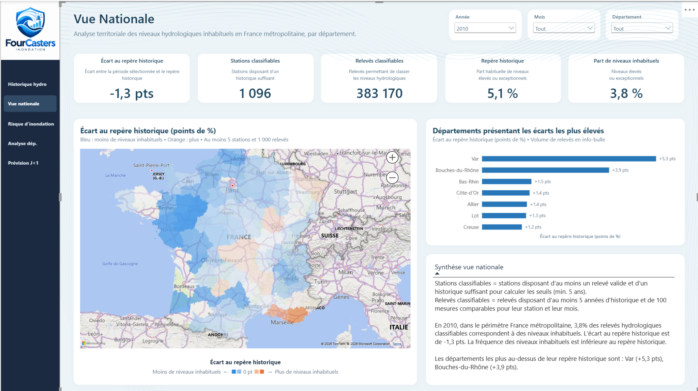
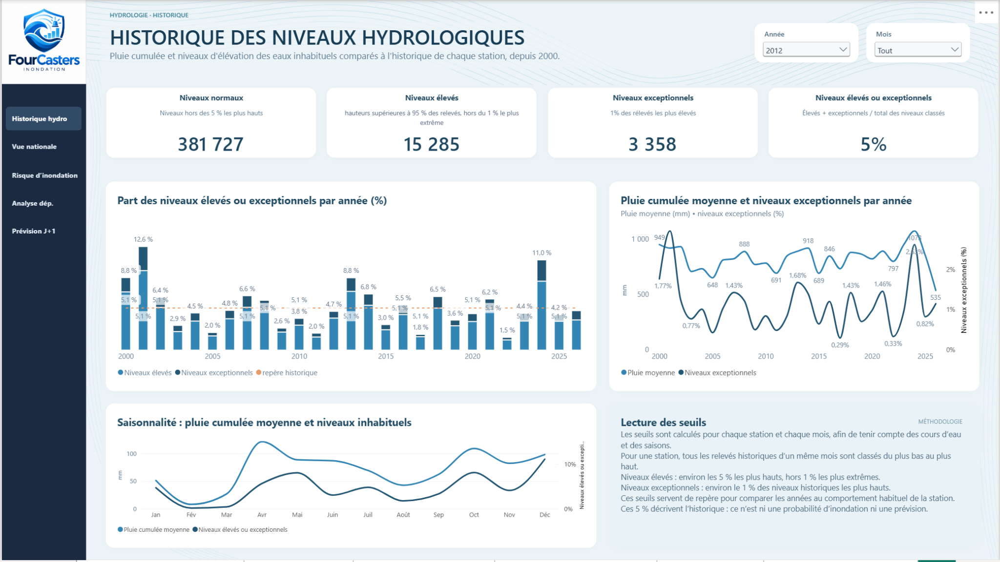
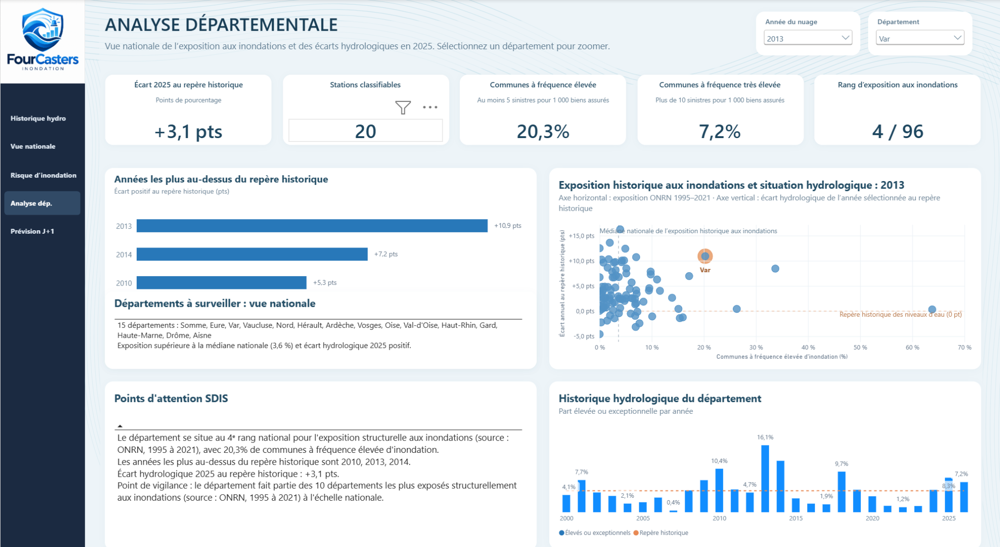
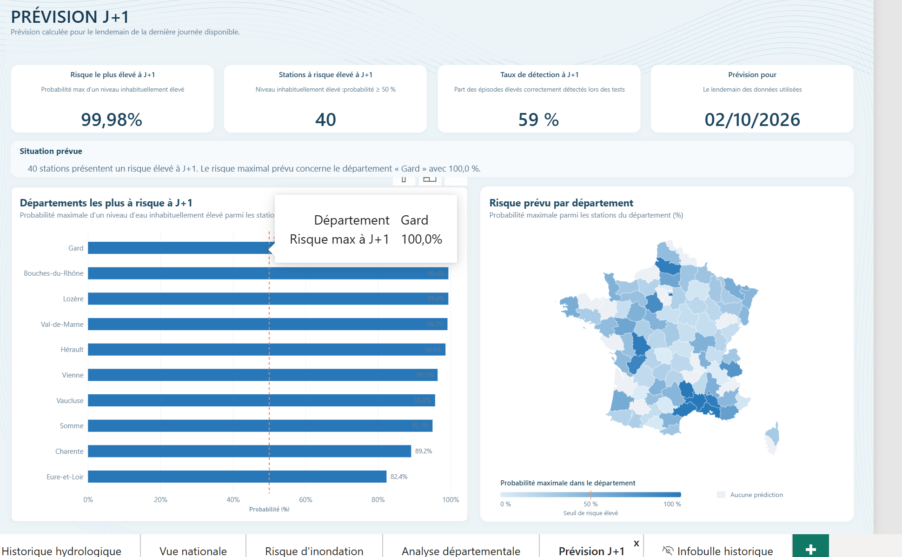

# FourCasters | Hydrologie, météo et tableaux de bord

**Projet collectif réalisé pendant la formation Data Analyst de la Wild Code School.**

FourCasters rassemble des observations hydrologiques, des données météo et des indicateurs historiques de sinistres en France. Le projet automatise leur préparation dans BigQuery et les restitue dans Power BI. Une régression logistique explore la détection de dépassements d'un seuil hydrologique à J+1.

Python · BigQuery · SQL/dbt · Power BI · GitHub Actions · scikit-learn

[Voir les tableaux de bord](#tableaux-de-bord) · [Voir le notebook ML](notebooks/ml_fourcasters.ipynb) · [Reproduire les traitements](docs/reproduction.md)

## Tableaux de bord

### Vue nationale



*Capture du 12/10/2026, année 2010. Les écarts sont exprimés en points de pourcentage par rapport au repère historique de chaque station.*

<details>
<summary>Historique hydrologique et analyse départementale</summary>

### Historique hydrologique



*Capture du 12/10/2026, sélection 2012 pour les indicateurs. Les graphiques présentent les séries historiques depuis 2000.*

### Analyse départementale



*Capture du 12/10/2026, Var. Le bandeau porte sur 2025 ; le nuage utilise 2013, sélection visible en haut. L'exposition ONRN est une référence historique de 1995 à 2021.*

</details>

<details>
<summary>Prévision J+1 : capture et lecture du résultat</summary>



*Capture du 09/10/2026 : données au 01/10, cible au 02/10. Le KPI de 59 % concerne les nouveaux franchissements du P95. Son sous-titre « épisodes élevés » est trop large et reste à corriger dans Power BI. Les scores du modèle concernent un dépassement hydrologique ; leur calibration n'est pas démontrée.*

</details>

Les captures sont conservées telles qu'elles ont été fournies. Le fichier Power BI et les mesures DAX ne sont pas publiés dans ce dépôt.

## Du traitement à la restitution

La chaîne reste **Python → BigQuery → SQL/dbt → Power BI**, avec GitHub Actions pour l'exécution et scikit-learn pour le ML.

| Étape | Travail réalisé | Code |
| --- | --- | --- |
| Collecte | Appels Open-Meteo et Hub'Eau, pagination, gestion des erreurs et reprises | [src/](src/), [load_data.py](load_data.py) |
| Stockage RAW | Hash de contenu, historique des versions, date d'insertion et identifiant de lot | [bigquery_utils.py](src/bigquery_utils.py) |
| Préparation | Typage, dernière version par clé, jointures géographiques et tables de faits | [Modèles dbt](fourcasters/models/) |
| Contrôles | Unicité, références entre tables, qualité hydro et cas limites météo | [Tests SQL](fourcasters/tests/), [tests locaux](tests/) |
| Restitution | Indicateurs, cartes et exploration dans Power BI | Captures ci-dessus |
| Inférence | Chargement de la régression logistique et écriture des résultats dans BigQuery | [predict.py](predict.py) |

Sources utilisées : [Open-Meteo](https://open-meteo.com/), [Hub'Eau](https://hubeau.eaufrance.fr/) et les fichiers publics ONRN. Le [référentiel géographique](fourcasters/seeds/referentiel_geographique.csv) contient 360 communes ou points d'intérêt.

Le staging conserve la dernière version RAW de chaque clé métier. Un contenu identique à la version courante est ignoré ; une séquence A → B → A conserve les trois versions. Les ajouts d'un lot peuvent être annulés en cas d'erreur.

Les seuils P90/P95/P99 sont calculés par station et mois sur les observations qualifiées. Le mart hydro est reconstruit à chaque exécution pour appliquer les mêmes seuils actualisés aux journées anciennes et récentes. Les versions RAW sont conservées. Le [schéma dimensionnel](docs/images/schema-dimensionnel.svg) est une vue de travail ; les modèles dbt décrivent les tables actuellement versionnées.

## Machine learning

**Objectif :** prédire si la hauteur maximale journalière d'une station atteindra ou dépassera son P95 historique le lendemain des données utilisées.

Le modèle conserve cinq variables :

| Variable | Calcul |
| --- | --- |
| `position_p95` | Position du niveau à J : `(hauteur − P95) / (P99 − P90)` |
| `variation_position_1j` | Variation entre J−1 et J, si les jours sont consécutifs |
| `pluie_j` | Pluie journalière de la commune |
| `pluie_3j` | Cumul J−2 à J : trois dates distinctes avec une pluie renseignée chacune |
| `humidite_sol` | Humidité du sol à 7–28 cm |

Le pipeline scikit-learn applique une imputation médiane, une standardisation et une régression logistique avec `class_weight="balanced"`. La cible `target_j1` est calculée avec l'observation exactement à J+1. Les journées sans cible sont exclues de l'entraînement et conservées pour l'inférence.

Le [notebook ML](notebooks/ml_fourcasters.ipynb) contient l'exploration, la séparation chronologique, les sorties d'évaluation et la comparaison avec la persistance. Les sorties enregistrées portent sur un jeu de **1 796 900 lignes et 247 stations**, du 01/01/2000 au 30/09/2026, référencé au 07/10/2026. L'entraînement utilise les dates avant 2023 et le test celles à partir de 2023.

| Évaluation enregistrée | Précision | Rappel | F1 |
| --- | ---: | ---: | ---: |
| Régression logistique, tous les dépassements | 32,6 % | 87,7 % | 47,6 % |
| Persistance, tous les dépassements | 69,9 % | 69,9 % | 69,9 % |
| Régression logistique, nouveaux franchissements | 10,6 % | 59,19 % | 17,9 % |

Les nouveaux franchissements sont les passages de sous le P95 à J vers le seuil ou au-dessus à J+1 : **3 007 détectés sur 5 080**. La faible précision implique beaucoup de faux positifs. La persistance est meilleure en F1 global ; lorsqu'une station est sous le seuil à J, cette règle prédit zéro et ne détecte aucun nouveau franchissement.

Ces résultats précèdent les corrections de pluie et de qualité hydro des 11–12/10/2026. Ils ne sont pas attribués au jeu corrigé ni au fichier `.pkl` chargé par `predict.py`. Le notebook contient une cellule distincte, sans sortie enregistrée, pour évaluer ce fichier avec vérification de son empreinte SHA-256.

## Automatisation et limites

[run_pipeline.py](run_pipeline.py) enchaîne collecte, `dbt run`, l'ensemble des tests dbt et inférence. Une étape en erreur arrête la suite. Le [workflow](.github/workflows/pipeline.yml) s'exécute quotidiennement, manuellement et après une modification du code sur `main` ; les exécutions sont sérialisées.

- **Dates :** l'ingestion conserve un recul de sept jours. J+1 désigne le lendemain de la dernière date exploitable, qui peut déjà être passée à la consultation. Les logs indiquent cette date et l'âge des données.
- **Reprise :** la fenêtre de révision reste de 35 jours ; une interruption plus longue est rattrapée à partir des dates déjà chargées. Hub’Eau utilise une date commune à la source pour éviter de confondre une station arrêtée avec une panne. L'historique initial reste une préparation distincte.
- **Interprétation :** un dépassement statistique de hauteur ne mesure pas des dommages. Le projet reste une expérimentation de formation, sans fonction d'alerte officielle.
- **Évaluation :** les seuils utilisent tout l'historique disponible. Une validation prospective devra les calculer avec les seules observations passées et réévaluer le modèle sur les données corrigées.
- **Couverture :** les règles de qualité et les dates manquantes peuvent réduire le nombre de lignes ou de stations exploitables.

La méthode de collecte, de contrôle et de reporting peut servir d'exemple pour rapprocher des exports de production, suivre des indicateurs qualité ou consolider des flux logistiques dans une PME. Ces usages n'ont pas été réalisés dans FourCasters.

## Vérifications et reproduction

Après installation de [requirements.txt](requirements.txt), les contrôles locaux ne demandent aucune clé GCP :

```bash
python -m unittest discover -s tests -v
```

Le [workflow de validation](https://github.com/eddy370/FourCasters/actions/runs/38227785621) a réussi le 12/10/2026 : **24 tests locaux**. Le [pipeline cloud du même jour](https://github.com/eddy370/FourCasters/actions/runs/38227785704) a construit **12 modèles**, réussi **49 tests dbt** et écrit **12 prédictions** à partir des données du **05/10**, pour une cible au **06/10**.

Cette dernière journée ne couvre que **12 stations** après les contrôles de qualité. Les 247 stations du retest décrivent le jeu historique ; la disponibilité quotidienne peut être nettement plus faible. Ce résultat vérifie l'exécution et les règles de données, sans actualiser les métriques ML.

Les étapes détaillées, les données historiques nécessaires et les commandes BigQuery/dbt sont dans [reproduction.md](docs/reproduction.md). [corrections_qualite.md](docs/corrections_qualite.md) consigne les défauts corrigés et leurs vérifications.

Les notebooks se trouvent dans [notebooks/](notebooks/). Les scripts historiques de [Script/](Script/) et `src/chargement_openmeteo_historique.py` sont conservés et distincts du traitement quotidien.

Les documents Word de [docs/](docs/) sont les documents initiaux de formation : cahier des charges, éthique, sobriété et dépendances. Ils conservent des intentions et consignes de travail datées. Le cas SDIS est un scénario pédagogique ; aucune mission client n'est revendiquée. Le présent README décrit l'état actuel du dépôt.
